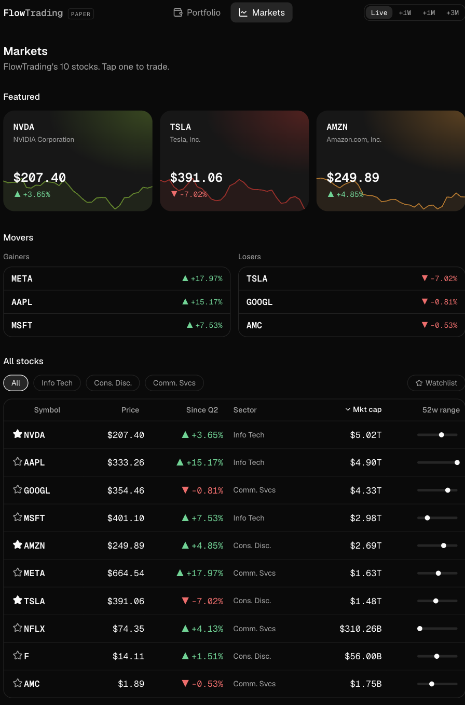

# FlowTrading - build a paper-trading app with Claude Code

A hands-on workshop. In ~2 hours you'll build **FlowTrading**: a dark, mobile-first
paper-trading app where you start with virtual cash, buy and sell 10 real US
stocks at seeded prices, and track your cost basis and profit/loss per stock.

You won't hand-write most of it. You'll **drive Claude Code** with clear prompts,
verify what it built, and course-correct. The point of the workshop is learning
to steer an AI coding agent well, not memorizing React.

> 📖 **Browsing on GitHub?** Start with the [Workshop guide →](./WORKSHOP.md).
> It walks you through the whole build, one prompt at a time.
>
> 🎤 **Following along live?** The [workshop slides & companion page →](https://joshuamdeguzman.com/claude-workshop)
> have the deck, links, and setup steps.

---

## 🎯 What you'll build

Four screens, that's the whole app:

1. **Dashboard** - account summary (total value, cash, invested, return) + your holdings
2. **Stock detail** - the hero screen: big price, an interactive brand-colored chart, 52-week range, your position
3. **Buy / Sell** - trade in shares *or* dollars, with validation, at seeded prices
4. **Screener** - the 10 stocks: featured cards, gainers/losers, a sortable table



Everything runs in the browser. **No backend, no database, no API keys.** Prices
are seeded static data; your account lives in `localStorage`.

---

## ✅ Prerequisites

- **Node.js 20+** and **npm** (`node -v` should print `v20` or higher)
- **[Claude Code](https://claude.com/claude-code)** installed and signed in
- A **GitHub account** (for the ship-it-early Vercel deploy) and a modern browser

That's it. No cloud accounts, no paid APIs.

---

## 🚀 Quickstart

```bash
# 1. Clone and install (from the repo root)
git clone https://github.com/joshuadeguzman/workshop_flowtrading.git
cd workshop_flowtrading
npm install

# 2. Run the dev server
npm run dev
```

Open **http://localhost:3000**. Then open **Claude Code** in the same folder and
say hello - it will read `CLAUDE.md` automatically and know the house rules.

> 💡 If `npm run dev` ever exits on its own in a detached shell, run the app
> directly instead: `cd apps/web && npx next dev`.

---

## 🧭 How this workshop works

You build FlowTrading in **6 steps**, each a focused prompt to Claude Code
followed by a quick check. Ship to Vercel after **Step 1**, while it's still
ugly - deploying early is the point.

| Step | You build | Key files |
|------|-----------|-----------|
| **1** | Scaffold + render the 10 stocks + **deploy to Vercel** | `data/stocks.ts` |
| **2** | Dashboard: account summary + holdings | `app/page.tsx` |
| **3** | Buy / Sell flow wired to `localStorage` | `app/trade/[symbol]/` |
| **4** | The portfolio math (cost basis, realized vs unrealized P&L) | `lib/portfolio.ts` |
| **5** | Stock detail: the hero screen + chart | `app/stock/[symbol]/` |
| **6** | Screener: featured, movers, sortable table | `app/screener/page.tsx` |

➡️ **Full instructions: [WORKSHOP.md](./WORKSHOP.md)**

---

## 📦 What's in this repo

```
apps/web/            The Next.js 16 app (App Router, TypeScript, Tailwind v4)
packages/ui/         Shared shadcn/ui primitives + theme tokens
AGENTS.md            The house rules - one source of truth, read by every agent
CLAUDE.md            A pointer to AGENTS.md (@AGENTS.md) for Claude Code
.claude/skills/      5 skills (Next 16, review, tests, verify, scaffold)
.claude/agents/      4 subagents (code + compliance review, test writer/runner)
WORKSHOP.md          The step-by-step build guide
```

**Agent instructions - one source of truth.** `AGENTS.md` holds the project's
conventions (data is ground truth, money formatting, P&L accessibility, dark
theme, motion rules) and is read natively by Cursor, Codex, and others. `CLAUDE.md`
is just `@AGENTS.md`, so Claude Code reads the same content - nothing drifts.

**Skills** (`.claude/skills/`, invoke as `/<name>`):

| Skill | Use it when |
|---|---|
| `next-best-practices` | You hit a Next 16 surprise (async `params`, hydration) |
| `adversarial-code-review` | Reviewing a change, with a score + optional GitHub comment |
| `write-tests` | Adding unit / component / e2e tests |
| `verify-app` | Checking the app still builds, lints, and runs all 4 screens |
| `new-screen` | Scaffolding a new route that follows the conventions |
| `e2e-capture` | Playwright flow + screenshots/recording to attach to a PR |
| `create-github-issue` | Filing a scoped, templated issue |
| `create-github-pull-request` | Opening a PR + an auto fresh-context review posted to the PR |
| `implement-issue` | A GitHub issue ID, taken end to end into a reviewed PR with visual proof |

**Subagents** (`.claude/agents/`): `code-reviewer` (adversarial, scored),
`compliance-reviewer` (house-rules enforcer), `test-writer`, and `test-runner`.
Ask Claude, e.g. *"run the code-reviewer on my recent changes."*

**Contributing?** The standardized change flow (issue → branch → build → verify →
PR → automatic review) is in **[CONTRIBUTING.md](./CONTRIBUTING.md)**. Set up the
contributor tooling below first.

---

## 🛠️ Contributor tooling setup

The workshop build itself needs only Node + Claude Code (see Prerequisites). The
**contribution flow** (issues, PRs, auto-review, visual proof, deploy) drives a
few external tools. You can use them two ways, and they mix freely:

- **MCP servers** (recommended) - this repo ships a [`.mcp.json`](./.mcp.json)
  with the official **GitHub** and **Vercel** remote MCP servers. Claude Code
  picks it up automatically when you open the repo. Approve the servers when
  prompted, then run **`/mcp`** to authenticate each one via OAuth in the browser
  (no tokens or API keys to copy or commit).
- **CLIs** - the `.claude/` skills also work through the `gh` and `vercel` CLIs
  if you'd rather not use MCP. Either path satisfies the flow.

| Tool | Used by | MCP setup | CLI alternative |
|---|---|---|---|
| **GitHub** | `create-github-issue`, `create-github-pull-request`, `implement-issue` | Shipped in `.mcp.json`; run `/mcp` and sign in | `brew install gh` then `gh auth login` ([cli.github.com](https://cli.github.com)) |
| **Vercel** | Deploy (see below) | Shipped in `.mcp.json`; run `/mcp` and sign in | `npm i -g vercel` then `vercel login`, or just import on [vercel.com/new](https://vercel.com/new) |
| **Playwright** | `e2e-capture`, `attach-screenshot` | not MCP | `npm i -D @playwright/test && npx playwright install chromium` (once, from `apps/web`) |
| **Claude Code** | Everything in `.claude/` | reads `.mcp.json` | [claude.com/claude-code](https://claude.com/claude-code); sign in on first run |

**Quick check** before you open your first PR:

```bash
# In Claude Code
/mcp                                 # github + vercel show "connected"

# In a terminal
gh auth status                       # (CLI path) GitHub is logged in
gh repo view --json nameWithOwner    # points at your fork / this repo
npx playwright --version             # Playwright is installed (for screenshots)
```

> The `.mcp.json` only lists **remote, OAuth-based** servers, so it holds no
> secrets and is safe to commit. Each contributor authenticates with their own
> account via `/mcp`. If you prefer different MCP servers, edit your own Claude
> Code config; the skills work with either the MCP servers or the CLIs.

---

## ☁️ Deploy

Deploys to **Vercel** straight from this monorepo:

1. Push your fork to GitHub.
2. Import it on [vercel.com](https://vercel.com/new).
3. Set the **Root Directory to `apps/web`**. Framework preset: Next.js. No other config.

No `basePath`, no static export, no GitHub Actions. See the deploy section in
[WORKSHOP.md](./WORKSHOP.md#-ship-it-to-vercel-do-this-after-step-1).

---

## 📚 Reference

- [Workshop slides & companion page](https://joshuamdeguzman.com/claude-workshop) - the deck and live-session links
- [Claude Code docs](https://docs.claude.com/en/docs/claude-code)
- [Next.js App Router](https://nextjs.org/docs/app)
- The seeded data and its quirks are documented at the top of `apps/web/data/stocks.ts`.

### Credit

Built for a [Claude Code workshop](https://joshuamdeguzman.com/claude-workshop) by [@joshuadeguzman](https://github.com/joshuadeguzman).
The `next-best-practices` skill is adapted from the community
[claude-code-nextjs-skills](https://github.com/laguagu/claude-code-nextjs-skills)
collection and the official Next.js docs.

## License

MIT.
